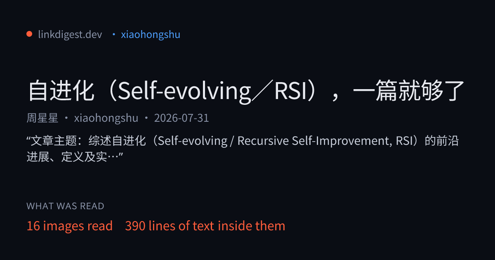

# LinkDigest MCP server

**中文文档：[README.zh-CN.md](README.zh-CN.md)** — 小红书 MCP / 抖音 MCP / B站 MCP / 公众号链接读取：MCP 服务器 + API、Python SDK、命令行，价格以人民币标注。

The social media reading layer for AI agents: turn a social media link into
text a language model can read — **transcript, on-screen text, image
descriptions, caption and metadata**, with quotes checked against the post.

**A Chinese social media API for AI agents:** Xiaohongshu (RedNote, 小红书), Douyin (抖音),
Weibo (微博), WeChat Official Account articles (公众号), Bilibili and 小宇宙 / Apple Podcasts episodes — plus
TikTok, YouTube, X and Instagram — read into timed transcripts, OCR of every image and frame, top
comments and key points with checked quotes. No Chinese phone number, account or cookies. Not read
today: Zhihu, Kuaishou. Overview: [linkdigest.dev/china-social-media-api](https://linkdigest.dev/china-social-media-api).

**Bilibili video → Markdown notes** (timed outline, key points, transcript; multi-part batches): a single-file CLI in [`examples/bilibili`](examples/bilibili/) · B站视频 → Markdown 笔记：`examples/bilibili`。

```bash
# A Douyin video's spoken script (文案), 1 credit per started 2 minutes
curl -X POST https://linkdigest.dev/api/v1/digest -H "Authorization: Bearer ld_live_..." \
  -H "Content-Type: application/json" -d '{"url": "https://v.douyin.com/xxxxxxx/", "depth": "script"}'
```

Hosted, remote (streamable HTTP). Nothing to install or run. For stdio-only clients and scripts,
[`python/`](python/) adds a zero-dependency Python SDK, a `linkdigest` command line and a
`linkdigest-mcp` stdio server that forwards to the hosted endpoint.

**Website:** [linkdigest.dev](https://linkdigest.dev) · **Registry:** `dev.linkdigest/linkdigest`

[](https://linkdigest.dev/d/5d0e7837ec2742ea4ae07806d979f0ce)

*Every digest comes with a receipt — how much was read, and a checked quote behind each key point. Works from Muse, Grok Bot, Manus Cue, Hermes, OpenClaw, Claude Code and Cursor: see [linkdigest.dev/connect](https://linkdigest.dev/connect). No key needed for a first look.*

## What this repository contains

The open parts: the Python SDK, the `linkdigest` command line and the `linkdigest-mcp` stdio server
([`python/`](python/), MIT), a LangChain tool and a LlamaIndex reader (in the SDK), the Dify
plugin source ([`dify/`](dify/)), the agent skill ([`skills/`](skills/)), examples, and the official MCP registry entry ([`server.json`](server.json)).
The hosted service behind `https://linkdigest.dev/mcp` and the API is operated by LinkDigest; its
reading engine is not open source.

## The problem

Fetching a social link yourself returns nothing useful. Share URLs are tokenised
(`xsec_token`, `app_code_link`), the content lives in video and images rather
than HTML, and the server sends an app-download shell or a login wall instead of
the post.

```
$ curl -sL 'https://xhslink.com/o/1WiQ1QI6Uc0' | grep -o '<title>.*</title>'
<title>小红书 - 你的生活兴趣社区</title>
```

That title belongs to a 36 KB app shell (checked 2026-10-04). No caption, no images, no text of the note.

## Install

**Claude Code**

```
claude mcp add --transport http linkdigest \
  https://linkdigest.dev/mcp \
  --header "Authorization: Bearer ld_live_..."
```

**Cursor, as a plugin** — this repo is a Cursor plugin (`.cursor-plugin/plugin.json` + `mcp.json` + `skills/`).
Install it from [cursor.directory](https://cursor.directory), then set the key once in your shell:

```
export LINKDIGEST_API_KEY=ld_live_...
```

The plugin's `mcp.json` reads `${LINKDIGEST_API_KEY}`; no key is stored in the repo. Without it,
the tool still lists and `tools/call` returns a 401 that says where to get one.

**Cursor, by hand** — `~/.cursor/mcp.json`

```json
{
  "mcpServers": {
    "linkdigest": {
      "url": "https://linkdigest.dev/mcp",
      "headers": { "Authorization": "Bearer ld_live_..." }
    }
  }
}
```

**stdio-only clients** — through [mcp-remote](https://github.com/geelen/mcp-remote) (Node.js):

```json
{
  "mcpServers": {
    "linkdigest": {
      "command": "npx",
      "args": ["-y", "mcp-remote", "https://linkdigest.dev/mcp", "--header", "Authorization:${AUTH_HEADER}"],
      "env": { "AUTH_HEADER": "Bearer ld_live_..." }
    }
  }
}
```

or through the Python server, published on PyPI as [`linkdigest-mcp`](https://pypi.org/project/linkdigest-mcp/)
(built and uploaded by this repo's release workflow, with attestations; needs uv):

```json
{
  "mcpServers": {
    "linkdigest": {
      "command": "uvx",
      "args": ["linkdigest-mcp"],
      "env": { "LINKDIGEST_API_KEY": "ld_live_..." }
    }
  }
}
```

A key is issued at [linkdigest.dev/app/keys](https://linkdigest.dev/signin?ref=github-mcp&next=/app/keys).
10 free credits to start, once per account, no card. A post is one credit; video adds one per
started minute; a viral breakdown or a translation adds one each. Then $5 once for 250 credits
(Alipay accepted, settled as ¥36) or $9 a month for 500 (card).

## Agent skills (OpenClaw, Hermes, Claude Code, Cursor and others)

25 ready-made skills live in [`skills/`](skills). Each is one job, a `SKILL.md` plus one script that uses only the Python standard library. The single-link readers (marked ★) work **without a key for a first look**: no `LINKDIGEST_API_KEY` gives a summary, up to 2 a day per address; with a key (10 free credits on sign-up, no card) they return the full transcript and per-image text.

| Skill | Job |
| --- | --- |
| `bilibili-video-to-text` | B站视频总结 / 转文字: a Bilibili video (BV link or b23.tv) as a timed transcript, on-screen text and key points |
| `bilibili-course-notes` ★ | B站网课笔记: a lecture or a whole 分P course as Markdown notes — timed outline, key points with quotes, `[mm:ss]` transcript, one file per part |
| `video-to-mindmap` | 视频转思维导图: a long video's timed outline as markmap Markdown (branches with start–end times) |
| `douyin-batch-to-text` | 抖音批量视频转文字: a batch of Douyin links (one creator's series) read at once, one Markdown file per video plus an index table; speech-only read by default |
| `xiaohongshu-batch-export` | 小红书笔记批量导出: a batch of Xiaohongshu notes as Markdown files — body, the words in every image (OCR), video transcript, hot comments — plus an index table |
| `douyin-video-to-text` ★ | 抖音视频转文字: a Douyin video's spoken words, on-screen text, chapters |
| `douyin-search-to-text` | 抖音搜索转文字: search Douyin by topic, then read the videos you pick |
| `xiaohongshu-note-to-text` ★ | 小红书笔记转文字: a Xiaohongshu note, the text in every image, caption, stats |
| `xiaohongshu-search-to-text` | Search Xiaohongshu (RedNote) by topic, then read the notes you pick |
| `xiaohongshu-consumer-insight` | One Xiaohongshu note as consumer insight: audience, selling points, objections, purchase intent, each with a checked quote |
| `xiaohongshu-douyin-compare` | 2–10 Xiaohongshu / Douyin / TikTok / YouTube links compared on one page |
| `xiaohongshu-daily-draft` | A daily brief for one niche plus a ready-to-post draft by email; never touches or posts to your account |
| `tiktok-transcript` ★ | A TikTok video's transcript with timestamps and captions |
| `instagram-to-text` | An Instagram reel or post as transcript, on-screen text and caption |
| `weibo-to-text` ★ | 微博转文字: a Weibo post's text, image text, video transcript and top comments |
| `podcast-to-text` | 播客转文字: a 小宇宙 or Apple Podcasts episode as a timed transcript with show notes |
| `long-video-transcript` ★ | 长视频转文字: lectures and replays up to 2 h, 1 credit per 2 minutes |
| `linkdigest-xhs-note-ocr` ★ | Xiaohongshu image notes, with the text inside every image |
| `linkdigest-video-transcript` ★ | Douyin / Xiaohongshu video to transcript and on-screen text |
| `linkdigest-wechat-article-reader` ★ | WeChat 公众号 articles: full text and every image's text |
| `linkdigest-youtube-summary` ★ | YouTube summary and timed transcript, translated to Chinese on request |
| `linkdigest-xiaohongshu-douyin-reader` ★ | Read Xiaohongshu / Douyin posts in English |
| `linkdigest-viral-breakdown` ★ | How a viral post is built, with quotes checked against the source |
| `linkdigest-script-rewrite` ★ | Extract a reference video's script and structure, then write your own |
| `linkdigest` | The general one: any social link or web page that returns nothing useful when fetched |
| `xiaohongshu-pain-point-radar` | 痛点雷达: a category on Xiaohongshu + Douyin → pain points, needs and blockers counted per post by code (N/M), search demand from Baidu/Taobao/Bing suggestions, and gaps nobody answers; quotes checked word for word |
| `overseas-pain-points` | 出海痛点: the same for overseas buyers on YouTube + TikTok, report in Chinese with the English originals |

**Pain-Point Radar** (2026-11-07) is one REST call: `POST https://linkdigest.dev/api/v1/radar` with `{"topic": "robot vacuum", "market": "global"}` (or `"cn"` for Xiaohongshu + Douyin), then poll `GET /api/v1/radar/{id}`; a 12-post run is ~41–47 credits and takes 10–20 minutes. Public examples, each dated with its read: [国内品类](https://linkdigest.dev/zh/tongdian-leida) · [出海品类](https://linkdigest.dev/zh/chuhai-tongdian).

```bash
# Any agent the skills CLI supports (Claude Code, Cursor, Codex, OpenClaw, Trae, Qwen Code, ...)
npx skills add jcaiagent7143-ui/linkdigest-mcp --skill xiaohongshu-note-to-text

# Hermes Agent
hermes skills install jcaiagent7143-ui/linkdigest-mcp/skills/xiaohongshu-note-to-text
hermes skills install clawhub/linkdigest-xhs-note-ocr   # or from ClawHub

# OpenClaw (ClawHub)
clawhub install jackchew7143/linkdigest-xhs-note-ocr
```

## The tool

`digest_url(url, format, job_id, translate_to, breakdown, ask, partial_ok, depth)` — only `url` is required.

| Argument | Notes |
|---|---|
| `url` | The post URL, including any share tokens. |
| `format` | `markdown` (default, best for reading) or `json` (structured). |
| `job_id` | Collect a digest already running. Pass this instead of `url` — re-sending the url would start the work again. |
| `breakdown` | `true` adds a viral breakdown (爆款拆解): the hook in its first seconds, the structure as timed beats, the title formula, cover text, call to action, audience and a reusable template. Quotes are checked word for word against the post; engagement and hashtags come from the platform. +1 credit. |
| `translate_to` | An ISO 639-1 code (`en`, `ja`, `zh-CN`): adds a translation beside the original, and writes the breakdown in that language. +1 credit. |
| `ask` | A question to answer from the post ("what products and prices does it recommend?", "does the speaker say X?"). The answer comes with the quotes it rests on, each checked word for word against the post; `found` is false when the post does not say, and nothing is invented. +1 credit. |
| `partial_ok` | `true` reads the opening minutes the budget affords instead of refusing a long video. |

You do not call it yourself. The tool description tells the agent to reach for it
whenever it meets a social link it cannot read, so it happens mid-task without
being asked.

A long video may not finish inside one call. When that happens the result names a
job id; call the tool again with that `job_id` and no `url` to collect it.

## What comes back

`platform`, `author`, `title`, `posted_at`, `caption`, `transcript` (`{t, text}`),
`ocr_text`, `on_screen` (`{t, text}`), `images` (`{description, ocr}`), `key_points`, `stats`
(likes, comments, saves, shares, plays), `tags`, `raw_markdown`, `source_url`, `transcript_source`,
`degraded` — plus `breakdown` and `translation` when asked for.

Two are worth knowing about:

- **`transcript_source`** — `native_captions`, `asr`, `gemini_video` or `none`. Captions the
  platform already published are exact; speech recognition is not. `gemini_video`
  means a YouTube video without captions was watched by Gemini, which wrote the
  transcript and its times. Treating them
  identically eventually quotes a mis-heard number back at someone as fact.
- **`degraded`** — what did not fully work, in plain words, plus notes on how a
  complete read was obtained (e.g. "read via oEmbed", "read by Gemini watching the
  video directly").
  It exists because a digest once returned a well-formed, completely empty result
  during a provider outage and was cached for thirty days.

## Platforms

Checked against real posts, not documentation.

| Platform | Status |
|---|---|
| Xiaohongshu 小红书 | Works — image notes and video notes, no login needed |
| Douyin 抖音 | Works — video posts and image notes (图文), through Douyin's own embed player |
| Weibo 微博 | Works (since 2026-11-01) — text, photos, video, counts, top comments, through Weibo's own visitor page; posts only followers can see are refused, not charged |
| WeChat 公众号 articles | Works — the full article, every image read |
| Bilibili | Works (since 2026-10-24) — videos and b23.tv short links, through Bilibili's own embed player |
| 小宇宙 / Apple Podcasts | Works (since 2026-10-29) — episode transcripts |
| TikTok | Works — short links resolve. Rate-limits under load |
| YouTube | Works — native captions where published, otherwise a watched transcript |
| X | Works — posts with video or images |
| Instagram | Works (since 2026-10-24) — reels, and photo posts through Instagram's embed page (a carousel reads its first slide) |
| Web pages / articles | Works — readable article text, title, author, date |
| **Zhihu, Kuaishou** | **Not read yet** |
| **Facebook** | **Not supported.** Serves no post content to logged-out requests |

The rows that do not work are listed on purpose. Finding out after you have wired
something in is worse than knowing now.

## How long it takes

Measured, not estimated:

- Already-digested link: about **1 second** — anything anyone has run before is
  cached, and cached links are free
- Xiaohongshu note with images: **1–2 minutes**
- YouTube video with captions: about **2.5 minutes**

## Notes

- Speech is transcribed with Qwen3-ASR. It was kept over whisper-large-v3-turbo
  after a side-by-side on the same clips, where Whisper misheard Mandarin
  (创业 → 创意, 900人 → 酒派人).
- `transcript` is `[{t, text}]`. Platform captions are timed per line. Speech
  recognition currently returns one segment per ~170 s of audio (a single
  segment at `t: 0` for a shorter clip); `on_screen` carries approximate,
  keyframe-level times.
- Media is never stored or served. It is processed in a temporary directory
  deleted before the request returns; only the text digest is kept.
- A blocked or removed post returns an error, not a description of the error page.

## Python SDK and command line

In [`python/`](python/): MIT, Python 3.10+, standard library only.

```bash
pip install linkdigest-mcp          # PyPI; or from this repo: pip install "git+https://github.com/jcaiagent7143-ui/linkdigest-mcp#subdirectory=python"
export LINKDIGEST_API_KEY=ld_live_...
linkdigest "https://v.douyin.com/xxxx/" --breakdown       # Markdown to stdout
linkdigest capture ./video.mp4 --url "<link>"              # a video you already have: sound + frames extracted here, never uploaded
```

```python
from linkdigest import LinkDigest

d = LinkDigest().digest("https://xhslink.com/o/xxxx", translate_to="en")
print(d.title, d.credits, d.cached)
print(d.markdown)
```

Long jobs are collected for you (`GET /api/v1/digest/{jobId}?wait=20`); errors are typed
(`PaymentRequiredError` carries `buy_url`). Examples — Dify, OpenAPI import for Coze-style
platforms, Feishu Bitable, links to CSV — are in [`examples/`](examples/) (Chinese).

## LangChain

`LinkDigestTool` is a LangChain tool (`digest_url`): the model passes a link, and gets the post back as
markdown — transcript with times, on-screen text, key points, a Coverage line. Through a ToolCall the full
JSON is on the ToolMessage as `artifact`. A 402 (out of credits) comes back as a sentence with the pay link,
and a long read still running comes back as a job id the model collects on its next call.

```python
# pip install "linkdigest-mcp[langchain]" langchain
from langchain.agents import create_agent
from linkdigest.integrations.langchain import LinkDigestTool

agent = create_agent("anthropic:claude-sonnet-5-5", tools=[LinkDigestTool(max_credits=10)])
agent.invoke({"messages": [{"role": "user", "content": "What does this video sell? https://v.douyin.com/xxxx/"}]})
```

`LinkDigestTool(output="json")` gives the model compact JSON instead. Example: [`examples/python/langchain_agent.py`](examples/python/langchain_agent.py).

## LlamaIndex

`LinkDigestReader` turns links into LlamaIndex `Document`s: the markdown as text, and flat metadata
(`platform`, `title`, `author`, `source_url`, `posted_at`, `credits`, `coverage_*`) that any vector store
accepts. A link that cannot be read is logged and skipped (`errors="raise"` to stop instead).

```python
# pip install "linkdigest-mcp[llamaindex]" llama-index
from llama_index.core import VectorStoreIndex
from linkdigest.integrations.llamaindex import LinkDigestReader

docs = LinkDigestReader(depth="script").load_data(["https://v.douyin.com/xxxx/", "https://b23.tv/xxxx"])
VectorStoreIndex.from_documents(docs).as_query_engine().query("What do these videos have in common?")
```

`depth="script"` reads the speech only, the cheapest read. Example: [`examples/python/llamaindex_reader.py`](examples/python/llamaindex_reader.py).

## Link parsing (offline, free, no key)

`linkdigest.links` finds the real link in pasted share text and names the post it points to — platform,
post id and the post's clean address — with no API key and no network. `resolve()` also follows a short
link (v.douyin.com, xhslink.com, b23.tv, t.co, vt.tiktok.com …) by reading its redirects, nothing else:
no page body, no cookies, at most 5 hops, an honest User-Agent.

```python
from linkdigest.links import extract_url, identify, resolve

text = "7.32 复制打开抖音，看看【…的作品】 https://v.douyin.com/G8Oggg_IXMA/ E@u.Ib 复制此链接"
extract_url(text)                     # 'https://v.douyin.com/G8Oggg_IXMA/'
identify("https://m.bilibili.com/video/BV1stVH66E6G?p=2&share_source=copy").canonical_url  # '…/BV1stVH66E6G/?p=2'
resolve(text).post_id                 # '7680883233307342947' (one redirect read)
```

Command line: `linkdigest-links "<share text>"` prints JSON (`--offline` skips the redirect). Douyin,
Xiaohongshu (xsec_token kept literally), Bilibili, Weibo (mid → bid), YouTube, TikTok, X, Instagram,
Kuaishou, WeChat articles and podcast episodes. The same rules as the free parser at
[linkdigest.dev/zh/lianjie-jiexi](https://linkdigest.dev/zh/lianjie-jiexi). `pip install linkdigest-mcp` (0.2.5 or later).

## Dify

The same tool as a Dify plugin lives in [`dify/`](dify/) — source, manifest and privacy policy. Install it from the Dify Marketplace and paste your API key into the provider credential.

## Also available

A REST API (`POST https://linkdigest.dev/api/v1/digest`), a web app, and Apify
Store actors for bulk runs. See [linkdigest.dev](https://linkdigest.dev).

## License

MIT — see [LICENSE](LICENSE). Changes are listed in [CHANGELOG.md](CHANGELOG.md).
